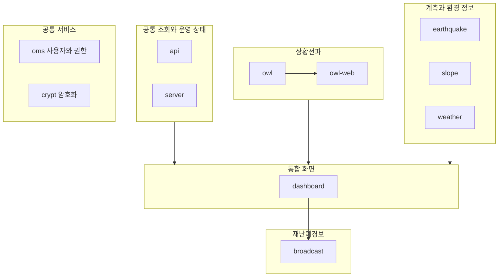

# 울산 재난관리 통합관제 플랫폼

**11개 모듈로 구성된 재난관리 통합관제 플랫폼을 단독 개발했습니다.**

재난·시설·계측·기상 정보를 하나의 지도와 관제 화면에서 확인하고, 상황전파와 재난예경보 업무를 지원하는 플랫폼입니다. 외부 시스템의 데이터를 수집·변환하는 백엔드부터 실시간 관제 화면까지 설계하고 구현했습니다.

## 담당 역할

| 구분 | 담당 범위 |
| --- | --- |
| 개발 구성 | 단독 개발 |
| 설계 | 모듈 구성, 데이터 흐름, API, DB 구조와 업무별 데이터 관리 책임 |
| 프론트엔드 | 지도·관제 패널, 업무별 화면, API 연동과 상태 처리 |
| 백엔드 | 데이터 수집·변환·저장·조회, 실시간 전송과 외부 시스템 연계 |
| 공통 서비스 | 기존 운영관리·암호화 서비스의 울산 맞춤 수정 및 적용·연동 |
| 검증·운영 | 테스트 환경 구성, 기능 검증, 배포와 운영 대응 |

## 11개 모듈과 구현 범위

| 모듈 | 역할 | 직접 구현·적용한 내용 |
| --- | --- | --- |
| `dashboard` | 통합 GIS 관제 화면 | 지도·관제 패널과 업무별 화면, 모듈 API 연결, 기능별 구조 정리와 mock·테스트 환경 |
| `api` | 공통 데이터와 시설물 조회 | 지도·시설물 조회 API, 주소검색 연계, 응답·오류 처리, DB 구조와 화면 서빙 |
| `server` | 서버·네트워크 운영 상태 | 장비별 상태 수집, 수집값 저장·조회, 상태 판정과 운영 현황 API |
| `owl` | 상황전파 메시지 연계 | 외부 메시지 조회·변환, 주소·좌표 정보 보강과 최근 메시지 제공 |
| `owl-web` | 상황전파 데이터 서비스 | 메시지 중복 방지 저장, 지역 매핑·검색과 SSE 실시간 전달 |
| `earthquake` | 지진 계측과 이벤트 수집 | 계측 스트림 구독·검증·재연결, 계측기 조회와 지진 이벤트 수집 |
| `slope` | 급경사지 계측과 상태 관리 | 계측 현황·차트·발령 필요 상태 조회, 캐시·조회 실패 대응과 단계 구간 이력 |
| `broadcast` | 자동음성·문자전광판 연계 | 매체별 전송 어댑터, 요청 처리, 단말·문구 관리와 전송 결과·이력 저장 |
| `weather` | 기상·대기 정보 수집 | 기상 실황·예보·특보·레이더·대기질 API 연계, 데이터 변환과 주기 수집·조회 |
| `oms` | 사용자·부서·이벤트 권한 | 기존 운영관리 제품의 울산 맞춤 수정, 권한 검증과 호출 이력 연계 |
| `crypt` | 공통 암호화 서비스 | 기존 암호화 서비스의 울산 적용과 연동 구성 |

## 전체 구조

모듈별 역할과 주요 데이터 흐름을 정리한 개념도입니다.

각 업무 모듈이 담당 데이터의 수집·변환·저장·조회를 맡고, 대시보드가 업무별 API를 활용하도록 구성했습니다. 공통 지도 데이터와 업무별 데이터의 관리 책임을 구분하고, 기존 사용자·권한 및 암호화 서비스를 함께 적용했습니다.

## 주요 설계와 해결한 문제

### 외부 데이터 수집과 화면 갱신 분리

외부 시스템마다 조회 주기와 응답 형식이 달라, 수집 단계에서 데이터를 변환하고 화면에 필요한 응답 모델을 분리했습니다.

상황전파는 `owl`이 외부 메시지를 조회·변환하고, `owl-web`이 중복 저장을 방지하며 신규 메시지를 SSE(Server-Sent Events)로 전달하도록 구성했습니다. 외부 조회와 화면 구독을 분리해 화면 접속 수에 따라 외부 요청이 반복되는 것을 방지했습니다.

### 연결 중단과 일시적인 조회 실패 대응

실시간 계측 스트림에는 수신값 검증과 재연결을, 화면 SSE에는 연결 유지 처리를 적용했습니다. 급경사지 조회에는 캐시와 마지막 성공값 제공을 구현해, 외부 조회가 일시적으로 실패해도 이전에 수집한 정보를 제공하도록 했습니다.

### 계측 시계열과 단계 이력 모델링

계측 데이터의 현재값·시계열·단계 변화를 각각의 용도에 맞게 처리했습니다. 급경사지 단계는 변화 시점을 기준으로 구간 이력을 관리하고, 원천 데이터의 시간 기준과 저장·표시 기준을 구분해 시간대 차이로 인한 오류를 다뤘습니다.

### 업무별 데이터와 모듈 경계 정리

공통 지도·시설물 조회, 상황전파, 계측, 방송, 운영 상태를 별도 모듈로 나눴습니다. 각 모듈이 관리하는 DB 구조와 조회 API를 구분해 데이터 변경 책임을 명확히 했습니다.

`broadcast`는 자동음성과 문자전광판의 서로 다른 전송 방식을 어댑터로 분리하고, 요청 처리 결과와 통신 이력을 저장하도록 구현했습니다. `oms`는 울산 업무에 맞게 사용자·부서·이벤트 권한 검증과 호출 이력을 연계했습니다.

### 화면과 백엔드의 독립적인 검증 환경

대시보드에 mock 서버와 테스트 도구를 구성해 백엔드 연결 없이 화면 동작을 확인할 수 있도록 했습니다. 응답 지연과 조회 실패 상황을 재현하는 경로를 마련하고, 백엔드 단위 테스트와 화면 테스트를 기능별로 구성했습니다.

## 기술 구성

| 구분 | 주요 기술 |
| --- | --- |
| 업무 백엔드 | Java 17, Spring Boot 3.4, Spring Data JPA |
| 기존 공통 서비스 | Java·Spring, JPA·QueryDSL, JSP·jQuery |
| 대시보드 | TypeScript, React, Vite |
| 데이터 저장·조회 | PostgreSQL, 모듈별 외부 데이터 연계 |
| DB 스키마 관리 | Flyway, 모듈별 SQL |
| 실시간 통신 | SSE |
| 빌드 | Gradle, Maven, pnpm |
| 테스트 | 백엔드 단위 테스트, Vitest, Playwright |
